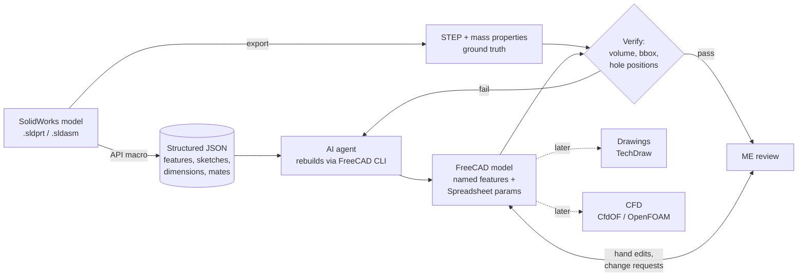
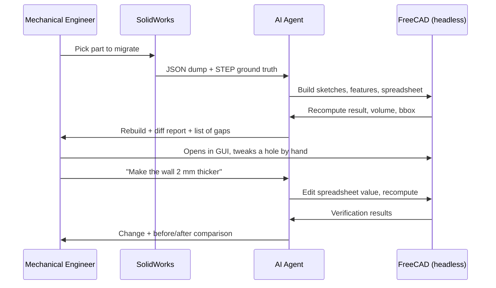

# mech-cad-ai-workflow

A pitch deck for an AI-assisted SolidWorks-to-FreeCAD mechanical design workflow.

## The one-liner

**Keep SolidWorks for what it’s good at. Extract design intent into open, versioned data, and let AI agents help iterate on it while the engineer stays in control.**

## The pipeline



## Who does what



## Why an ME would care

| Pain today | What this gives them |
|---|---|
| Design intent is locked in a proprietary file | Intent exported as readable, versioned JSON |
| Reviewing a change means opening the file and hunting | Git diffs, e.g. `wall_thickness: 3 → 5` |
| Repetitive edits across variants | The agent applies the change across parts and verifies it |
| Licenses limit who can open the model | FreeCAD is free, so anyone on the team can open it |
| Migration means rebuilding by hand | The agent drafts the rebuild and the engineer reviews it |
| Trust in the result | Every rebuild is checked against SolidWorks numbers |

## Objections you’ll hear, and honest answers

| Objection | Answer |
|---|---|
| "AI will hallucinate geometry." | The agent never has the last word. A script compares the rebuild to SolidWorks (volume, bounding box, hole positions). Failures are reported, not hidden. |
| "FreeCAD isn’t SolidWorks." | Agreed, and nobody is replacing SolidWorks. This is for rebuilds, variants, and open collaboration. Pilot it on simple parts first. |
| "Not everything will convert." | Correct. Lofts, surfaces, and some patterns won’t map cleanly. The dump logs what it couldn’t represent, so gaps are visible up front. |
| "I don’t want to be locked out of my own model." | You can open and hand-edit the FreeCAD model at any point, and the agent reads your changes back. |
| "What about our IP?" | Everything can run locally. If you use a cloud AI model, tool results and file contents go into the conversation, so use your company policy to decide. |
| "Who maintains the macro?" | A small, single-purpose script, drafted with AI and reviewed by an engineer. Its scope is part of the pilot. |

## The pilot

| Phase | Scope | Success criterion |
|---|---|---|
| 1 | One simple part (bracket with holes and a fillet) | Rebuild matches volume and bounding box within tolerance |
| 2 | Hand-edit test: ME changes a feature in the GUI, then the agent changes another | Both edits survive and the model recomputes cleanly |
| 3 | One small assembly | Mates and positions reproduced |
| 4 | Time comparison against a manual rebuild | Measured and honest, even if the answer is "not faster yet" |
| 5 (later) | Drawing and CFD experiments | Treated as experiments, not promises |

## Example contract JSON

```json
{
  "schema_version": "0.1",
  "units": "mm",
  "part": "bracket_A",
  "parameters": { "thickness": 3.0, "hole_dia": 6.5, "hole_spacing": 40.0 },
  "features": [
    { "type": "sketch", "name": "BaseProfile", "plane": "XY" },
    { "type": "extrude", "name": "BasePad", "depth": "thickness" },
    { "type": "hole", "name": "MountHoles", "diameter": "hole_dia" }
  ],
  "ground_truth": { "volume_mm3": 12840.2, "bbox": [60, 40, 3] },
  "unsupported": []
}
```

## What’s proven and what isn’t

| Piece | Status |
|---|---|
| SolidWorks API can traverse features and sketches | Well-established, though details vary by feature type |
| FreeCAD headless scripting and export | Established |
| Agent rebuilds simple parts accurately | Plausible, needs a pilot |
| Hand edits survive agent changes | Needs a pilot |
| Assemblies, drawings, CFD | Experimental |

## The ask

**Give us two weeks and one bracket. If the numbers don’t match, we stop.**
